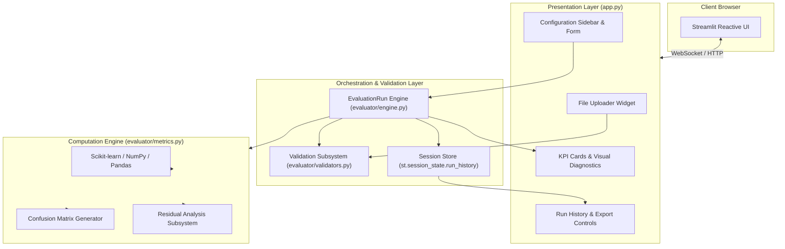
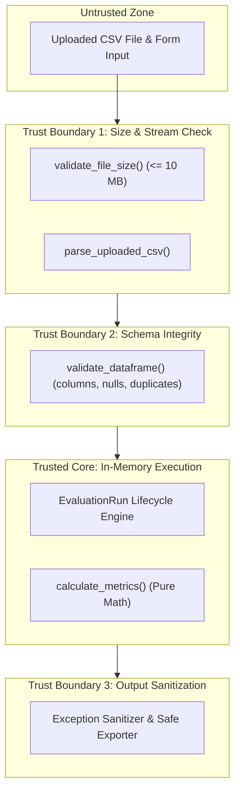
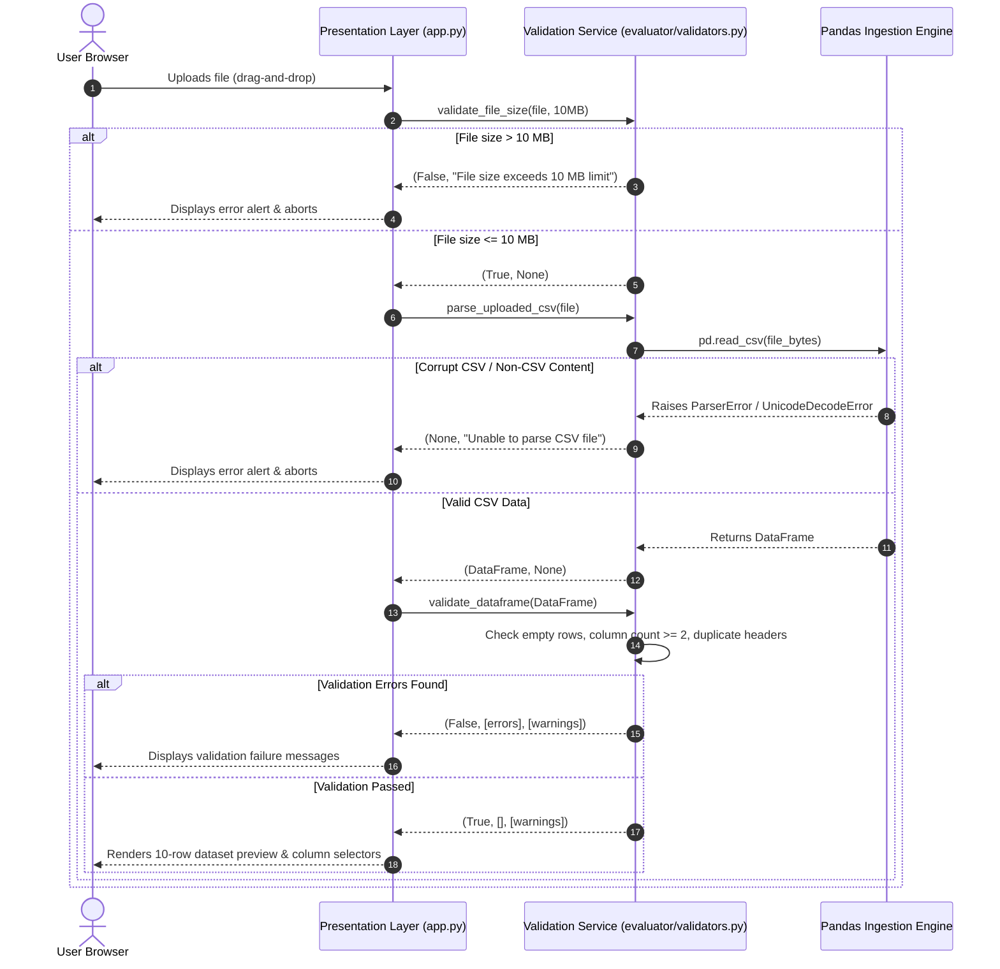
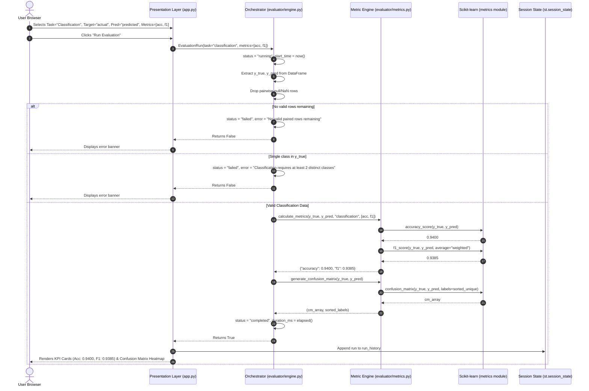

# DELIVERABLE 3 — SOFTWARE ARCHITECTURE AND DESIGN SPECIFICATION (SAD)
## Web-Based ML Model Evaluator

**Document Identifier:** SAD-WBMLE-2026-V2.0  
**Status:** Approved / Development Freeze  
**Date:** 3 November 2026  
**Standards Compliance:** IEEE Std 1016-2009 (Standard for Information Technology — Systems Design — Software Design Descriptions)  
**Authors / Project Team:**
- **Prajwal Sunnagar** (`@prajwalsunnagar`) — ML Evaluation Engine Lead
- **Shreyank S** (`@ShreyankSridhar`) — Documentation & UI Lead
- **Skanda** (`@skandaml21`) — Backend Architecture & QA Lead
- **Sujal** (`@sujalththth-ops`) — Integration & Reporting Lead

---

## 1. Introduction

### 1.1 Purpose
This Software Architecture and Design Specification defines the high-level architecture, module decomposition, internal component interfaces, data flows, sequence workflows, security boundaries, and design decisions for the **Web-Based Machine Learning (ML) Model Evaluator**. It bridges the system requirements defined in the SRS (`docs/SRS-REVISED.md`) with the concrete Python implementation in `app.py` and the `evaluator/` package.

### 1.2 System Overview
The Web-Based ML Model Evaluator is an offline evaluation platform for supervised machine learning models. The application runs as a single-process web application built on Python and Streamlit, leveraging Pandas for tabular manipulation, NumPy for array math, and Scikit-learn for standardized statistical metric computations. The application executes evaluations entirely in-memory and retains run history within the active browser session.

### 1.3 Architectural Scope & Reality Alignment
Unlike speculative enterprise multi-service designs, this application adheres to a clean, decoupled **Layered Modular Web Architecture**:
- It does **not** rely on an external relational database (e.g., PostgreSQL) or distributed messaging queues; all evaluation state is maintained in volatile Streamlit session state (`st.session_state`).
- It does **not** expose a separate public REST API daemon; client communication occurs over WebSockets via Streamlit's reactive framework, while internal services communicate through strictly typed Python function contracts.
- Metric calculation logic is encapsulated inside an independent `evaluator` package that has zero dependencies on Streamlit, ensuring complete unit testability.

---

## 2. Architecture Overview

### 2.1 Architectural Pattern
The application follows a 3-tier logical architecture implemented within a single Python runtime:
1. **Presentation Tier (`app.py`):** Reactive web interface utilizing Streamlit widgets for file uploading, dynamic form configuration, KPI cards, visual diagnostic matrices, and download triggers.
2. **Orchestration & Validation Tier (`evaluator/validators.py`, `evaluator/engine.py`):** Coordinates lifecycle management, enforces file and schema constraints, sanitizes exceptions, tracks execution time, and structures exportable run payloads.
3. **Core Computation Tier (`evaluator/metrics.py`):** Pure mathematical functions executing Scikit-learn algorithms with deterministic precision ($\epsilon = 10^{-6}$).



### 2.2 Component Decomposition & Responsibilities

| Component Name | Source File | Responsibilities | Traceability |
|---|---|---|---|
| **Presentation Controller** | `app.py` | Manages page layout, captures user interactions, binds inputs to session state, renders KPI metrics cards, confusion matrices, residual tables, and initiates downloads. | FR-01, FR-05, FR-08, NFR-08, NFR-12 |
| **Validation Service** | `evaluator/validators.py` | Enforces byte-level file size ceilings (`validate_file_size`), validates CSV headers and content streams (`parse_uploaded_csv`), and checks DataFrame structural integrity (`validate_dataframe`). | FR-02, FR-03, FR-04, SEC-01, SEC-02 |
| **Evaluation Orchestrator** | `evaluator/engine.py` | Encapsulates the `EvaluationRun` lifecycle (`pending` $\rightarrow$ `running` $\rightarrow$ `completed`/`failed`), generates UUIDv4 identifiers, records UTC timestamps, drops null rows, catches exceptions, and serializes reports. | FR-07, FR-09, FR-10, FR-14, NFR-02, NFR-11 |
| **Metric Computation Engine** | `evaluator/metrics.py` | Implements mathematical metric calculations for classification (Accuracy, Precision, Recall, F1 with weighted averaging) and regression (MAE, MSE, RMSE, $R^2$), natural label sorting, and residual statistics. | FR-05, FR-06, FR-07, BR-01–BR-05, NFR-03, NFR-09 |
| **Session History Store** | `st.session_state` (`app.py`) | Maintains in-memory FIFO list of `EvaluationRun` dictionaries, enables historical run inspection, and provides session history clearance. | FR-11, FR-12, NFR-07 |
| **Report Exporter** | `evaluator/engine.py`, `app.py` | Serializes run metadata and metric tables into RFC 8259 JSON and RFC 4180 CSV byte streams for client download. | FR-13 |

### 2.3 Data Flow Description
1. **Ingestion:** User selects a `.csv` file via Streamlit file uploader. The byte buffer is passed directly to `parse_uploaded_csv`.
2. **Structural Validation:** File size is verified $\le 10\text{ MB}$. Bytes are parsed into a Pandas DataFrame. The DataFrame is inspected for non-empty rows, duplicate column headers, and unnamed columns.
3. **Configuration:** User selects target column, prediction column, task type, and desired metrics.
4. **Execution Request:** User clicks "Run Evaluation". An `EvaluationRun` instance is instantiated in `pending` state, assigned a unique UUIDv4, and transitioned to `running`.
5. **Preprocessing:** Target and prediction columns are extracted. Pairwise null rows are detected and dropped; dropped count and remaining sample count are recorded.
6. **Computation:** The orchestrator invokes `evaluator.metrics.calculate_metrics`. Diagnostic data (confusion matrix or residual error summary) is generated.
7. **Completion & Linkage:** The run status is set to `completed`. Execution duration is calculated. The run is appended to `st.session_state.run_history`.
8. **Rendering:** Streamlit UI displays KPI summary cards, confusion matrix heatmap/table, residual error statistics, and download export buttons.
9. **Failure Branch:** If any check fails, the run status transitions to `failed`, a sanitized user-friendly error message is captured, the failed run is recorded in session history, and a danger alert is rendered.

### 2.4 Deployment Architecture

```mermaid
graph LR
    subgraph ExternalNetwork ["Public / External Network"]
        Client[User Browser]
    end

    subgraph HostServer ["Host Server / VM (Linux Ubuntu / macOS)"]
        Proxy["Reverse Proxy (NGINX / Caddy) TLS 1.3 Termination :443"]
        App["Streamlit Application Runtime (Python 3.10-3.12) :8501"]
        Mem["Process Memory (DataFrame & Session State)"]
    end

    Client <-->|HTTPS / WSS (Port 443)| Proxy
    Proxy <-->|HTTP / WS (Port 8501)| App
    App <--> Mem
```

- **Local Development:** Developers execute `streamlit run app.py`, binding directly to `http://localhost:8501`.
- **Production Deployment:** The Streamlit process runs behind a production-grade reverse proxy (such as NGINX or Caddy) handling TLS 1.3 termination, HTTP-to-HTTPS redirection, and WebSocket proxying (`Upgrade` / `Connection` headers).

### 2.5 Architectural Decisions (ADRs)

| ADR ID | Architectural Decision | Rationale | Trade-offs & Mitigations |
|---|---|---|---|
| **AD-01** | **Single-Process Streamlit Architecture** | Enables rapid, reactive development with native Python scientific stack integration, eliminating REST API overhead for offline evaluation. | Multi-user session persistence is memory-scoped; mitigated by clear documentation of ephemeral session boundaries. |
| **AD-02** | **Strict Decoupling of `evaluator/` Core** | Core metrics and validators have zero dependencies on Streamlit, UI elements, or HTML. | Facilitates 100% automated headless unit testing via pytest without needing a running browser or server. |
| **AD-03** | **In-Memory Streaming Validation** | Uploaded files are parsed directly from memory buffers without temporary disk writes. | Prevents file lingering, path traversal vulnerabilities, and filesystem permission issues (SEC-05, SEC-08). |
| **AD-04** | **Weighted Averaging for Multiclass Metrics** | Uses `average='weighted'` with `zero_division=0` for multiclass Precision, Recall, and F1. | Accounts for class imbalance and prevents crashes when classes have zero predicted samples. |
| **AD-05** | **Session-Scoped History Store** | Leverages `st.session_state` rather than an external database engine. | Keeps deployment zero-config; satisfies data privacy (NFR-07) by discarding data upon tab closure. |
| **AD-06** | **Exception Sanitization Layer** | All exceptions are caught in `EvaluationRun.execute()` and sanitized to generic, actionable messages. | Prevents leakage of internal stack traces, library internals, or filesystem paths to end users (SEC-06). |

---

## 3. Security Architecture

### 3.1 Trust Boundaries



- **Boundary 1 (Browser to Server):** All client uploads are treated as untrusted byte sequences. Checked for extension (`.csv`), MIME type (`text/csv`), and maximum size ($10\text{ MB}$).
- **Boundary 2 (Raw Data to Memory DataFrame):** CSV stream is parsed safely via Pandas; duplicate columns, blank headers, and empty files are rejected before invoking ML logic.
- **Boundary 3 (Internal Execution to UI):** Any arithmetic exception (division by zero, non-numeric strings, single class) is caught and sanitized into safe user-facing text; stack traces are never rendered to the DOM.

### 3.2 Security Controls Summary
- **No Arbitrary Code Execution:** The application does not invoke `eval()`, `exec()`, or `pickle.loads()`. Data is strictly parsed as tabular numbers or strings.
- **Memory-Only Processing:** No uploaded files or evaluation runs are written to disk. All data structures are garbage-collected when the user closes the browser session.
- **Zero Secrets Committed:** Static analysis confirms absence of hardcoded passwords, tokens, or private keys.

---

## 4. Design Specification & Detailed Workflows

### 4.1 Internal API & Component Interfaces

#### 4.1.1 Validation Module (`evaluator/validators.py`)
```python
def validate_file_size(file: Union[UploadedFile, BytesIO, bytes], max_size: int = 10 * 1024 * 1024) -> Tuple[bool, Optional[str]]:
    """Enforces byte size ceiling. Returns (is_valid, error_message)."""

def parse_uploaded_csv(uploaded_file: Any) -> Tuple[Optional[pd.DataFrame], Optional[str]]:
    """Safely decodes and parses CSV bytes into a DataFrame. Returns (df, error_message)."""

def validate_dataframe(df: pd.DataFrame) -> Tuple[bool, List[str], List[str]]:
    """Validates row count, column count, header uniqueness, and null distributions.
    Returns (is_valid, errors_list, warnings_list)."""
```

#### 4.1.2 Metric Calculation Module (`evaluator/metrics.py`)
```python
SUPPORTED_METRICS = {
    'classification': ['accuracy', 'precision', 'recall', 'f1'],
    'regression': ['mae', 'mse', 'rmse', 'r2']
}

def calculate_metrics(y_true: Union[pd.Series, np.ndarray, list],
                      y_pred: Union[pd.Series, np.ndarray, list],
                      task_type: str,
                      selected_metrics: List[str]) -> Dict[str, float]:
    """Computes requested metrics. Returns mapping of metric names to rounded floats."""

def calculate_residuals(y_true: np.ndarray, y_pred: np.ndarray) -> Dict[str, float]:
    """Computes residual error statistics: mean, std, min, max."""

def generate_confusion_matrix(y_true: np.ndarray, y_pred: np.ndarray) -> Tuple[np.ndarray, List[Any]]:
    """Computes confusion matrix with naturally sorted class labels."""
```

#### 4.1.3 Orchestration Engine Module (`evaluator/engine.py`)
```python
class EvaluationRun:
    def __init__(self, run_id: Optional[str] = None, source_filename: str = "",
                 task_type: str = "", actual_column: str = "", predicted_column: str = "",
                 selected_metrics: Optional[List[str]] = None):
        """Initializes run object with UUIDv4 and pending status."""

    def execute(self, df: pd.DataFrame) -> bool:
        """Executes full evaluation lifecycle: validates, drops nulls, computes metrics,
        records timing, transitions status to completed or failed."""

    def to_dict(self) -> Dict[str, Any]:
        """Serializes full run record to structured dictionary."""

    def to_json(self) -> str:
        """Serializes run report to formatted JSON string."""

    def to_metrics_csv(self) -> str:
        """Serializes metric summary to RFC 4180 CSV string."""
```

---

### 4.2 Sequence Diagram 1: CSV Upload & Validation Workflow



---

### 4.3 Sequence Diagram 2: Classification Evaluation Sequence



---

### 4.4 Sequence Diagram 3: Regression Evaluation Sequence with Residuals

```mermaid
sequenceDiagram
    autonumber
    actor User as User Browser
    participant UI as Presentation Layer (app.py)
    participant Eng as Orchestrator (evaluator/engine.py)
    participant Met as Metric Engine (evaluator/metrics.py)
    participant SK as Scikit-learn (metrics module)
    participant Session as Session State (st.session_state)

    User->>UI: Selects Task="Regression", Target="target", Pred="pred", Metrics=[mae, rmse, r2]
    User->>UI: Clicks "Run Evaluation"
    UI->>Eng: EvaluationRun(task="regression", metrics=[mae, rmse, r2])
    Eng->>Eng: status = "running", start_time = now()
    Eng->>Eng: Extract y_true, y_pred; check is_numeric_dtype
    alt Non-numeric string detected
        Eng->>Eng: status = "failed", error = "Regression requires numeric values."
        Eng-->>UI: Returns False
        UI-->>User: Displays error banner
    else Valid Numeric Data
        Eng->>Eng: Drop pairwise null rows
        Eng->>Met: calculate_metrics(y_true, y_pred, "regression", [mae, rmse, r2])
        Met->>SK: mean_absolute_error(y_true, y_pred)
        SK-->>Met: 2.1500
        Met->>SK: mean_squared_error(y_true, y_pred)
        SK-->>Met: 6.4500
        Met->>Met: rmse = sqrt(6.4500) = 2.5397
        Met->>SK: r2_score(y_true, y_pred)
        SK-->>Met: 0.8850
        Met-->>Eng: {"mae": 2.1500, "rmse": 2.5397, "r2": 0.8850}
        Eng->>Met: calculate_residuals(y_true, y_pred)
        Met-->>Eng: {"mean": -0.12, "std": 2.54, "min": -5.2, "max": 4.8}
        Eng->>Eng: status = "completed", duration_ms = elapsed()
        Eng-->>UI: Returns True
        UI->>Session: Append run to run_history
        UI-->>User: Renders KPI Cards, Residuals Table & Export Buttons
    end
```

---

## 5. Design Traceability Matrix

| Architectural Subsystem | Source Code Artifact | SRS Requirements Addressed |
|---|---|---|
| **Presentation Layer** | `app.py` | `FR-01`, `FR-05`, `FR-08`, `FR-11`, `FR-13`, `NFR-08`, `NFR-10`, `NFR-12` |
| **Validation Subsystem** | `evaluator/validators.py` | `FR-02`, `FR-03`, `FR-04`, `SEC-01`, `SEC-02`, `SEC-05`, `NFR-05` |
| **Evaluation Orchestrator** | `evaluator/engine.py` | `FR-07`, `FR-09`, `FR-10`, `FR-14`, `NFR-01`, `NFR-02`, `NFR-11`, `SEC-06` |
| **Metric Engine** | `evaluator/metrics.py` | `FR-05`, `FR-06`, `FR-07`, `BR-01`–`BR-05`, `NFR-03`, `NFR-09` |
| **Session History Store** | `st.session_state` (`app.py`) | `FR-11`, `FR-12`, `NFR-07`, `SEC-04`, `SEC-08` |
| **Report Exporter** | `evaluator/engine.py` | `FR-13`, `FR-14` |
| **Automated Test Harness** | `tests/` (124 tests) | `NFR-01`, `NFR-02`, `NFR-03`, `SEC-01`–`SEC-07` |
| **CI Automation** | `.github/workflows/ci.yml` | `NFR-09`, `NFR-10` |

