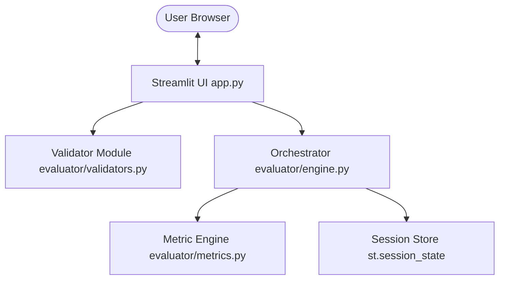
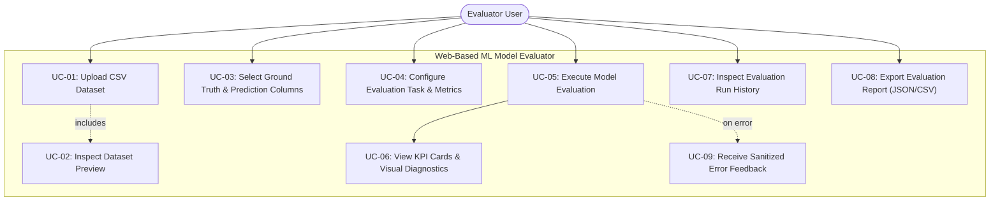

# DELIVERABLE 1 — SOFTWARE REQUIREMENTS SPECIFICATION (SRS)
## Web-Based ML Model Evaluator

**Document Identifier:** SRS-WBMLE-2026-V2.0  
**Status:** Approved / Development Freeze  
**Date:** 3 November 2026  
**Standards Compliance:** IEEE Std 830-1998 (Recommended Practice for Software Requirements Specifications)  
**Authors / Project Team:**
- **Prajwal Sunnagar** (`@prajwalsunnagar`) — ML Evaluation Engine Lead
- **Shreyank S** (`@ShreyankSridhar`) — Documentation & UI Lead
- **Skanda** (`@skandaml21`) — Backend Architecture & QA Lead
- **Sujal** (`@sujalththth-ops`) — Integration & Reporting Lead

---

## 1. Introduction

### 1.1 Purpose
This Software Requirements Specification (SRS) defines the functional, non-functional, interface, data, security, and quality requirements for the **Web-Based Machine Learning (ML) Model Evaluator**. The system enables data scientists, machine learning engineers, and academic evaluators to upload tabular predictions and ground truth labels, validate schemas, configure task-specific evaluation parameters, compute standardized performance metrics, inspect diagnostic visualizations, and export comprehensive evaluation reports.

### 1.2 Scope
The Web-Based ML Model Evaluator provides an interactive, browser-based environment for offline evaluation of supervised machine learning predictions.
- **In Scope:**
  - Ingestion of tabular dataset files in Comma-Separated Values (`.csv`) format up to 10 MB.
  - Multi-tier validation: MIME type check, file size verification, row count verification, column header uniqueness, null distribution checks, and data type compatibility.
  - Support for **Supervised Classification**: Accuracy, Precision (weighted), Recall (weighted), F1-Score (weighted), natural-sorted Confusion Matrix, and class distribution counts.
  - Support for **Supervised Regression**: Mean Absolute Error (MAE), Mean Squared Error (MSE), Root Mean Squared Error (RMSE), Coefficient of Determination ($R^2$), and Residual Error Summary (Mean, Standard Deviation, Min, Max).
  - Lifecycle state tracking (`pending`, `running`, `completed`, `failed`) with unique UUIDv4 run identifiers and timestamps.
  - Session-scoped evaluation run history and multi-format report export (JSON run report, CSV metrics summary, CSV history log).
  - Deterministic evaluation logic producing numerical repeatability within $\epsilon = 10^{-6}$.
- **Out of Scope:**
  - In-browser model training, hyperparameter tuning, or model fitting.
  - Arbitrary Python code execution or pickled model deserialization (`pickle`, `joblib`).
  - Online real-time streaming inference APIs.
  - Multi-tenant user account registration, database credential storage, and password authentication.

### 1.3 Definitions, Acronyms, and Abbreviations
| Term / Acronym | Definition |
|---|---|
| **API** | Application Programming Interface |
| **CSV** | Comma-Separated Values format (RFC 4180) |
| **Evaluation Run** | An atomic execution of evaluation logic against a pair of ground truth and prediction vectors under a specific metric configuration |
| **FR** | Functional Requirement |
| **Ground Truth ($y_{\text{true}}$)** | Reference benchmark labels or continuous target values representing true states |
| **IEEE** | Institute of Electrical and Electronics Engineers |
| **KPI** | Key Performance Indicator (visual metric cards) |
| **MAE** | Mean Absolute Error: $\frac{1}{n} \sum |y_i - \hat{y}_i|$ |
| **MSE** | Mean Squared Error: $\frac{1}{n} \sum (y_i - \hat{y}_i)^2$ |
| **NFR** | Non-Functional Requirement |
| **Prediction ($\hat{y}$)** | Model-generated discrete class labels or continuous predicted values |
| **$R^2$** | Coefficient of Determination: $1 - \frac{\sum (y_i - \hat{y}_i)^2}{\sum (y_i - \bar{y})^2}$ |
| **RMSE** | Root Mean Squared Error: $\sqrt{\text{MSE}}$ |
| **RTM** | Requirement Traceability Matrix |
| **SAD** | Software Architecture and Design Specification |
| **SEC** | Security Requirement |
| **SO** | Security Objective |
| **SRS** | Software Requirements Specification |
| **UI** | User Interface |
| **UUID** | Universally Unique Identifier (RFC 4122) |

### 1.4 Assumptions and Dependencies
- **A-01:** The application is accessed via modern evergreen web browsers (Chromium, Firefox, Safari/WebKit) with JavaScript enabled.
- **A-02:** Input data is provided as a pre-computed tabular CSV file containing at least two distinct columns representing ground truth and predictions.
- **A-03:** The hosting environment provides Python 3.10, 3.11, or 3.12 with at least 512 MB RAM and standard system libraries.
- **A-04:** Computational libraries (NumPy, Pandas, Scikit-learn) execute calculations deterministically on IEEE 754 floating-point hardware.
- **A-05:** Streamlit operates in a single-session in-memory context; persistence across browser refresh is not required.
- **A-06:** The application does not require a persistent relational database; run history is maintained in session state (`st.session_state`).
- **A-07:** Production deployment is fronted by a TLS/HTTPS reverse proxy (NGINX, Caddy, or Cloudflare).

### 1.5 Document Overview
Section 2 describes the product perspective, user characteristics, and operational constraints. Section 3 defines external interface requirements. Section 4 specifies functional requirements (FR-01 through FR-14) and business rules. Section 5 details non-functional requirements (NFR-01 through NFR-12). Section 6 defines logical data entities. Section 7 details security objectives and requirements. Section 8 provides acceptance criteria. Section 9 provides the UML Use Case model.

---

## 2. Overall Description

### 2.1 Product Perspective
The Web-Based ML Model Evaluator is an independent, lightweight web application developed using Python and Streamlit. It follows a layered software pattern:
1. **Presentation Layer (`app.py`):** Reactive web interface rendering upload controls, configuration inputs, KPI summary cards, confusion matrices, residual metrics, and export controls.
2. **Orchestration Layer (`evaluator/engine.py`):** Encapsulates the `EvaluationRun` lifecycle, generates UUIDv4 identifiers, tracks execution timestamps, sanitizes exceptions, and produces structured report payloads.
3. **Core Computation Layer (`evaluator/metrics.py`):** Pure numerical calculation module computing classification and regression metrics using Scikit-learn and Pandas.
4. **Validation Layer (`evaluator/validators.py`):** Enforces file format, size limits, schema integrity, and column constraints prior to computational invocation.

### 2.2 Product Functions
- Ingest CSV evaluation files up to 10 MB.
- Display dataset previews and structural metadata (row count, column count, null cell counts).
- Validate dataset schema, column uniqueness, and non-empty rows.
- Support user selection of target (actual) and prediction columns.
- Support user selection of task type (Classification or Regression) and compatible metrics.
- Execute metric computation with automatic dropping of pairwise null/NaN rows.
- Display calculated metrics in high-visibility KPI cards rounded to 4 decimal places.
- Render confusion matrix with natural label ordering for classification.
- Render residual statistics (mean, standard deviation, minimum, maximum) for regression.
- Maintain an in-memory history of completed and failed runs within the browser session.
- Export run reports in JSON format and metrics summaries in CSV format.
- Provide safe, sanitized error feedback without exposing stack traces or internal paths.

### 2.3 User Classes and Characteristics
- **ML Practitioner / Data Scientist:** Uploads model evaluation outputs to assess accuracy, precision/recall trade-offs, and error distributions. Requires clear metric definitions and downloadable reports.
- **Academic Evaluator / Reviewer:** Audits project artifacts, validates requirements against test execution reports, and verifies numerical correctness.
- **Software Engineer / Maintainer:** Extends metric calculation libraries, adds new evaluation algorithms, and maintains automated CI test suites.

### 2.4 Operating Environment
- **Server Runtime:** Python 3.10.x, 3.11.x, or 3.12.x running on Linux (Ubuntu 22.04+), macOS (12.0+), or Windows (10/11).
- **Key Dependencies:** Streamlit $\ge$ 1.38.0, Pandas $\ge$ 2.0.0, Scikit-learn $\ge$ 1.3.0, NumPy $\ge$ 1.24.0.
- **Client Requirements:** Modern web browser (Chrome 110+, Firefox 110+, Safari 16+, Edge 110+) with screen resolution $\ge 1280 \times 720$.

### 2.5 Design and Implementation Constraints
- **Constraint 1 (File Format):** Inputs must be strictly RFC 4180 compliant CSV files. Binary formats (.xlsx, .parquet, .pickle) are prohibited.
- **Constraint 2 (Upload Ceiling):** Maximum file size is strictly capped at $10\text{ MB}$ ($10 \times 1024 \times 1024$ bytes) to prevent resource exhaustion.
- **Constraint 3 (Security & Code Execution):** The application shall not deserialize Python byte-code or execute arbitrary expressions supplied in user data.
- **Constraint 4 (Determinism):** Calculations must be purely deterministic; repeated evaluations over identical inputs must yield identical float values within $\epsilon = 10^{-6}$.
- **Constraint 5 (Single Process Session):** Session state is held in ephemeral memory; no external database engine is required.

### 2.6 User Documentation
- `README.md`: Quickstart guide, architectural summary, running instructions, and test execution commands.
- `docs/demo/SPRINT-1-RECORDING-GUIDE.md`: Step-by-step 1-minute video narration guide.
- `docs/demo/SPRINT-2-RECORDING-GUIDE.md`: Step-by-step 2-minute video narration guide.
- `docs/TEST-EXECUTION-REPORT.md`: Comprehensive test execution log and coverage metrics.

---

## 3. External Interface Requirements

### 3.1 User Interfaces
- **UI-01 (Upload Interface):** A file drag-and-drop zone accepting `.csv` files. Clear labels state the 10 MB limit and required tabular structure.
- **UI-02 (Dataset Preview):** Upon successful upload, renders dataset dimensions (rows, columns, null count) and a preview table displaying the first 10 rows.
- **UI-03 (Configuration Controls):** 
  - Dropdown selectors for Ground Truth (Actual) and Prediction columns.
  - Radio button selector for Task Type (`Classification`, `Regression`).
  - Multi-select control dynamically populated with compatible metrics.
  - "Run Evaluation" action button.
- **UI-04 (Results Presentation):**
  - KPI summary cards displaying metric name and rounded 4-decimal value.
  - Visual diagnostics: Confusion matrix for classification; residual summary table (Mean, Std Dev, Min, Max) for regression.
  - Metadata banner: Evaluation Run ID, status badge, execution timestamp, sample count, and active row count.
- **UI-05 (History & Export Controls):**
  - Collapsible evaluation run history displaying previous runs in reverse chronological order.
  - Direct download buttons: "Download JSON Report", "Download Metrics CSV", and "Download Run History CSV".
  - "Clear History" button with confirmation state.

### 3.2 Software Interfaces
- **Pandas API:** Used for streaming file ingestion (`pd.read_csv`), dataframe validation, column inspection, and null row filtering.
- **Scikit-learn API:** Used for metric calculation (`accuracy_score`, `precision_score`, `recall_score`, `f1_score`, `confusion_matrix`, `mean_absolute_error`, `mean_squared_error`, `r2_score`).
- **Streamlit Session API:** Used for reactive UI rendering and managing `st.session_state.run_history`.

### 3.3 Hardware Interfaces
Standard server or local workstation hardware:
- Minimum 1 vCPU (x86_64 or ARM64).
- Minimum 512 MB available RAM.
- Minimum 100 MB disk space for dependencies and virtual environment.

### 3.4 Communications Interfaces
- Application listens locally on TCP port 8501 using HTTP/1.1 and WebSockets.
- In production, all communications shall be secured via TLS 1.3 over HTTPS (TCP port 443).

---

## 4. System Features and Functional Requirements

### 4.1 Requirement Conventions & Priorities
Requirements are numbered `FR-01` through `FR-14`. Priorities follow the MoSCoW framework:
- **Must Have (M):** Mandatory for core evaluation operations.
- **Should Have (S):** Critical for robust user experience and submission readiness.

### 4.2 Functional Requirements

| ID | Name | Priority | Requirement Description | Verification Method |
|---|---|---|---|---|
| **FR-01** | Input Upload | Must | The system shall allow the user to upload tabular evaluation datasets in `.csv` format via a web-based upload widget. | Automated Test & Inspection |
| **FR-02** | Upload Validation | Must | The system shall validate file extension and MIME type, rejecting non-CSV files with a descriptive, user-friendly error message. | Automated Test (`test_validation.py`) |
| **FR-03** | Size Limit Enforcement | Must | The system shall enforce a strict maximum upload size of 10 MB ($10,485,760$ bytes), rejecting oversized payloads prior to in-memory parsing. | Automated Test (`test_validation.py`) |
| **FR-04** | Schema & Structure Validation | Must | The system shall verify that the dataset contains at least 1 row, at least 2 distinct columns, contains no duplicate column names, and has valid headers. | Automated Test (`test_validation.py`) |
| **FR-05** | Task & Metric Configuration | Must | The system shall allow the user to select the evaluation task type (`Classification` or `Regression`) and select one or more compatible metrics. | AppTest Integration Test |
| **FR-06** | Metric Compatibility Enforcement | Must | The system shall reject task/metric combinations that are incompatible (e.g., MAE for classification, Accuracy for regression) and prevent execution. | Automated Test (`test_evaluator_modules.py`) |
| **FR-07** | Evaluation Execution | Must | The system shall execute metric calculations over paired target and prediction vectors, automatically dropping pairwise NaN rows prior to computation. | Automated Test (`test_classification.py`, `test_regression.py`) |
| **FR-08** | Result Presentation | Must | The system shall render computed metrics in prominent visual KPI cards (rounded to 4 decimal places), alongside confusion matrices (classification) and residual summaries (regression). | AppTest Integration Test |
| **FR-09** | Failure Handling & Error Sanitization | Must | If validation or computation fails, the system shall transition to `failed` status and display an actionable error message without exposing internal stack traces or filesystem paths. | Automated Test (`test_error_handling.py`) |
| **FR-10** | Run Status Lifecycle Tracking | Must | The system shall track the lifecycle state of each evaluation run through explicit states: `pending`, `running`, `completed`, or `failed`. | Automated Test (`test_evaluator_modules.py`) |
| **FR-11** | Session Run History | Should | The system shall record completed and failed evaluation runs in session history, allowing users to view prior runs, inspect execution parameters, and clear history. | AppTest Integration Test |
| **FR-12** | Multi-Tenant Run Isolation | N/A | The system operates in a single-tenant local browser session. Cross-user authentication is out of scope; isolation is guaranteed by ephemeral browser session memory. | Inspection & Architectural Review |
| **FR-13** | Multi-Format Report Export | Should | The system shall generate downloadable evaluation reports in JSON format (full metadata, parameters, and metrics) and CSV format (metrics summary and history table). | Automated Test (`test_evaluator_modules.py`) |
| **FR-14** | Input-to-Result Linkage | Must | The system shall associate each result with a unique UUIDv4 `run_id`, an ISO-8601 UTC timestamp, source filename, selected columns, sample counts, and metric parameters. | Automated Test (`test_evaluator_modules.py`) |

### 4.3 Business Rules and Metric Semantics
- **BR-01 (Task Compatibility):** Classification metrics (`Accuracy`, `Precision`, `Recall`, `F1-score`) apply only to discrete target variables. Regression metrics (`MAE`, `MSE`, `RMSE`, `R²`) apply only to continuous numerical variables.
- **BR-02 (Column Identification):** The user must select two distinct columns: Ground Truth ($y_{\text{true}}$) and Prediction ($\hat{y}$). Selecting identical columns for both roles is permitted for perfect-score benchmarking.
- **BR-03 (Missing Value Handling):** Any pairwise row where either $y_{\text{true}}$ or $\hat{y}$ is null/NaN is automatically dropped before computing metrics. If dropping nulls results in 0 usable rows, evaluation fails with a descriptive validation error.
- **BR-04 (Classification Averaging):** Multiclass Precision, Recall, and F1-score are computed using **weighted averaging** (`average='weighted'`) with `zero_division=0` to ensure safe evaluation in unbalanced or zero-prediction classes.
- **BR-05 (Regression Residuals):** Regression evaluations must compute residual errors ($e_i = y_i - \hat{y}_i$) and provide summary statistics: Mean error, Standard Deviation of error, Minimum error, and Maximum error.

---

## 5. Non-Functional Requirements (NFRs)

| ID | Quality Attribute | Measurable Requirement | Verification Method |
|---|---|---|---|
| **NFR-01** | Performance | For datasets up to $N_{\text{ROWS}} = 50,000$ within the 10 MB limit, 95% of evaluations shall complete within $T_{\text{EVAL}} \le 1.0\text{ second}$ on reference test hardware (Apple M-series or Intel i5+). | Benchmark Test (`test_evaluator_modules.py`) |
| **NFR-02** | Robustness & Availability | The application shall never crash or produce an unhandled exception when processing dirty, malformed, non-numeric, or single-class inputs. | Automated Test (`test_error_handling.py`) |
| **NFR-03** | Reliability & Determinism | Repeated evaluations over identical datasets and configurations shall yield numerically identical metric values within tolerance $\epsilon = 10^{-6}$. | Automated Test (`test_classification.py`, `test_regression.py`) |
| **NFR-04** | Transport Security | In deployed environments, all browser-to-server traffic shall be encrypted via HTTPS using TLS 1.3. Plaintext HTTP access shall be redirected to HTTPS. | Deployment Inspection |
| **NFR-05** | Secure File Handling | Uploaded files shall be parsed in-memory as byte streams without writing unvalidated files to the host filesystem. | Code Inspection & Test Suite |
| **NFR-06** | Secret Management | The repository and all application responses shall contain zero hardcoded credentials, secret keys, or environment tokens. | Automated Flake8 & Secret Scan |
| **NFR-07** | Privacy & Data Retention | Uploaded dataset contents and computed metrics shall remain strictly within volatile session memory and be discarded upon browser tab closure. | Code Review & Architecture Inspection |
| **NFR-08** | Usability | A user unfamiliar with the codebase shall be able to upload a sample dataset, execute an evaluation, and download an export within 60 seconds. | Usability Walkthrough (Sprint Demo) |
| **NFR-09** | Maintainability & Modularity | Evaluation calculation logic shall reside strictly in `evaluator/` and be 100% decoupled from the Streamlit UI presentation layer. | Automated Test & Import Inspection |
| **NFR-10** | Browser Compatibility | The application shall function without visual layout degradation on Chrome 110+, Firefox 110+, and Safari 16+. | Manual Multi-Browser Inspection |
| **NFR-11** | Observability & Logging | Every evaluation execution shall be logged with its `run_id`, timestamp, status, and duration without logging raw dataset rows. | Unit Test & Console Inspection |
| **NFR-12** | Accessibility | UI controls shall feature explicit textual labels, high contrast compliant with WCAG 2.1 AA, and support full keyboard navigation. | Accessibility Review |

---

## 6. Logical Data Requirements

### 6.1 Data Model
The system operates on four core logical entities:

1. **`DatasetInput`:**
   - `filename` (string): Original client file name.
   - `size_bytes` (integer): Total file size in bytes (max 10,485,760).
   - `total_rows` (integer): Total number of rows in the parsed DataFrame.
   - `total_columns` (integer): Total count of columns.
   - `columns` (list of strings): Unique header names.
   - `null_counts` (dictionary): Mapping of column names to missing value counts.

2. **`EvaluationRun`:**
   - `run_id` (string): UUIDv4 unique identifier.
   - `timestamp` (string): ISO-8601 UTC timestamp of execution.
   - `status` (string): Enum (`pending`, `running`, `completed`, `failed`).
   - `task_type` (string): `classification` or `regression`.
   - `actual_column` (string): Name of ground truth column.
   - `predicted_column` (string): Name of model prediction column.
   - `selected_metrics` (list of strings): List of metric identifiers to compute.
   - `sample_count` (integer): Number of paired rows evaluated after null filtering.
   - `dropped_null_count` (integer): Number of pairwise rows dropped due to NaN.
   - `execution_duration_ms` (float): Duration of calculation in milliseconds.
   - `error_message` (string, optional): Sanitized error message if status is `failed`.

3. **`MetricResult`:**
   - `run_id` (string): Foreign reference to parent `EvaluationRun`.
   - `metrics` (dictionary): Mapping of metric names to computed float values.
   - `diagnostics` (dictionary): Task-specific diagnostic objects (confusion matrix labels and values, residual mean, std dev, min, max).

4. **`RunHistorySession`:**
   - `runs` (list of `EvaluationRun`): In-memory stack of evaluation runs created in the active browser session.

### 6.2 Data Integrity Rules
- Each completed result must reference exactly one `run_id`.
- If an evaluation fails, `status` must be set to `failed`, `metrics` must be empty, and a sanitized `error_message` must be recorded.
- Metric values must never be reported as valid numbers if computation resulted in NaN or infinite values.

---

## 7. Security Objectives and Requirements

### 7.1 Security Objectives
- **SO-01 (Confidentiality):** Prevent unauthorized extraction or disclosure of uploaded dataset contents and evaluation metrics.
- **SO-02 (Integrity):** Ensure evaluation inputs and calculated metrics are immune to tampering or arbitrary code injection.
- **SO-03 (Availability):** Protect application server resources from exhaustion caused by oversized uploads or malformed input payloads.
- **SO-04 (Session Isolation):** Ensure user evaluations remain private to their respective local browser session.

### 7.2 Security Requirements

| ID | Requirement Description | Verification Method |
|---|---|---|
| **SEC-01** | Upload Size Ceiling: Enforce strict 10 MB payload limit before reading full content into memory. | Automated Test (`test_validation.py:test_file_exceeding_max_limit_rejected`) |
| **SEC-02** | Format & Content Verification: Validate file extension (.csv) and MIME content type; reject disguised executables or scripts. | Automated Test (`test_validation.py:test_non_csv_extension_rejected`) |
| **SEC-03** | No Code Execution: Treat uploaded files purely as text/data; never invoke `eval()`, `exec()`, or `pickle.loads()`. | Code Review & Static Analysis |
| **SEC-04** | Session Scoping: Maintain run history strictly in ephemeral session state (`st.session_state`); no persistent database cross-talk. | Architectural Inspection |
| **SEC-05** | Transport Security: Require TLS 1.3 HTTPS communication for deployed instances; disable unencrypted HTTP. | Deployment Configuration Review |
| **SEC-06** | Error Sanitization: Never expose internal stack traces, local absolute paths, or library internals in user-facing error banners. | Automated Test (`test_error_handling.py`) |
| **SEC-07** | Log Sanitization: Exclude raw dataset rows, credentials, and sensitive headers from application logging. | Log Inspection |
| **SEC-08** | In-Memory Ephemeral Storage: Do not persist uploaded CSV files to permanent server disk storage. | Code Review (`evaluator/validators.py`) |

---

## 8. Acceptance Criteria

1. **Upload & Validation:** A valid CSV dataset is parsed in $< 200\text{ ms}$; invalid extensions, oversized files (> 10 MB), duplicate columns, and empty datasets are cleanly rejected with visible feedback.
2. **Classification Correctness:** For a binary or multiclass dataset, computes Accuracy, Precision (weighted), Recall (weighted), and F1-score (weighted) matching Scikit-learn outputs within $\epsilon = 10^{-6}$; renders sorted Confusion Matrix.
3. **Regression Correctness:** For continuous targets, computes MAE, MSE, RMSE, and $R^2$; renders residual error summary (Mean, Std Dev, Min, Max).
4. **Error Handling:** Intentionally submitted invalid inputs (non-numeric regression columns, single-class classification datasets, 100% NaN columns) result in a `failed` run status and a sanitized error message without an application crash.
5. **Session Run History & Export:** Every execution creates a UUIDv4 run record in session history; JSON and CSV download buttons export complete, valid files.
6. **Automated Test Suite:** 100% of automated unit and integration tests (124 tests) pass with zero errors in $< 2.0\text{ seconds}$.
7. **CI Pipeline:** Multi-version GitHub Actions CI pipeline passes across Python 3.10, 3.11, and 3.12.

---

## 9. UML Use Case Model

### 9.1 Primary Use Case: UC-05 Execute Model Evaluation
- **Primary Actor:** Evaluator User (ML Practitioner / Student / Auditor).
- **Preconditions:** Application is running and accessible in a supported web browser; a valid CSV evaluation dataset is available.
- **Trigger:** User clicks "Run Evaluation" button.
- **Main Success Scenario:**
  1. System checks dataset schema and selected columns.
  2. System extracts ground truth ($y_{\text{true}}$) and prediction ($\hat{y}$) vectors.
  3. System filters out any pairwise rows containing NaN or null values.
  4. System verifies that task-specific preconditions are satisfied (e.g., numeric vectors for regression, $\ge 2$ classes for classification).
  5. System creates an `EvaluationRun` object in `running` state with a new UUIDv4 identifier and timestamp.
  6. System invokes `evaluator.metrics.calculate_metrics` for the chosen task and selected metrics.
  7. If classification, system computes confusion matrix with natural label sorting.
  8. If regression, system computes residual errors and residual summary statistics.
  9. System marks run status as `completed`, attaches metric dictionary and diagnostics, and records the run in session history.
  10. System displays KPI cards, visual diagnostic tables, and download export buttons.
- **Extensions (Alternative Flows):**
  - **4a. Non-numeric data in regression:** System records error "Regression requires numeric values. Column contains non-numeric data.", transitions run status to `failed`, adds failed run to session history, and renders a danger alert banner.
  - **4b. Single-class target in classification:** System records error "Classification requires at least 2 distinct classes in ground truth.", transitions run status to `failed`, and displays user-friendly warning banner.
  - **4c. Zero valid rows after null drop:** System records error "No valid paired rows remaining after filtering missing values.", transitions run status to `failed`, and halts computation safely.

